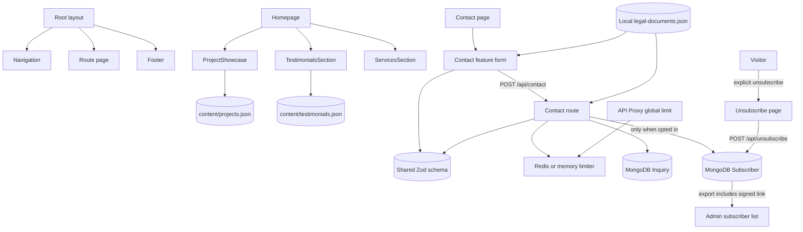
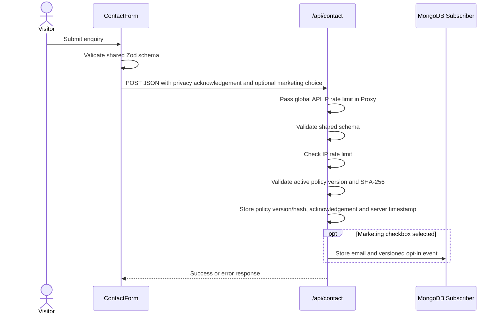

# Application architecture

## Purpose

This repository is the NLarge Global marketing website. Next.js App Router renders the public pages and delegates contact submissions to a server route that validates input and stores inquiries in MongoDB.

## Technology

| Concern | Implementation |
|---|---|
| Framework | Next.js 16 App Router |
| UI | React 19, TypeScript |
| Styling | Tailwind CSS 4 and `src/app/globals.css` |
| Fonts | Inter, Cormorant Garamond and Dancing Script through `next/font` |
| Forms | React Hook Form, resolver and shared Zod schema |
| Email | Nodemailer |
| Rate limiting | Centralized thresholds in `src/lib/rate-limit-config.ts`; Upstash Redis REST API with a process-memory fallback |
| Icons | React Icons |

## Folder structure

```text
src/
├── app/
│   ├── (marketing)/              # Marketing pages with transparent route-group URLs
│   │   ├── page.tsx              # /
│   │   ├── softwares/page.tsx    # /softwares
│   │   ├── services/page.tsx     # /services
│   │   └── guides/               # Practical editorial guides
│   │       ├── page.tsx          # /guides
│   │       └── [slug]/page.tsx   # Statically generated guide articles
│   ├── api/contact/route.ts          # Contact HTTP boundary
│   ├── api/unsubscribe/
│   │   ├── route.ts                  # Public unsubscribe action
│   │   └── request/route.ts          # Email-based unsubscribe link request
│   ├── unsubscribe/page.tsx          # Public email preferences page
│   ├── contact/page.tsx          # /contact
│   ├── support/page.tsx          # /support
│   ├── admin/                    # Private dashboard route surface
│   │   ├── layout.tsx            # Admin shell and admin-only metadata
│   │   ├── login/page.tsx        # Admin login
│   │   ├── prospects/            # Prospect list and detail pages
│   │   ├── page.tsx              # /admin overview placeholder
│   │   └── [section]/page.tsx    # Planned admin section placeholders
│   ├── api/admin/subscribers/   # Authenticated subscriber deletion
├── proxy.ts                      # Global rate limit for API routes
├── api/admin/auth/
│   │   ├── login/route.ts        # Login boundary
│   │   └── logout/route.ts       # CSRF-protected logout boundary
│   ├── privacy-policy/page.tsx
│   ├── terms-of-service/page.tsx
│   ├── layout.tsx                # Root layout and metadata
│   ├── robots.ts
│   └── sitemap.ts
├── components/
│   ├── layout/                   # Navigation and Footer
│   ├── sections/                 # Route-level presentation sections
│   ├── marketing/                # Reserved for reusable business presentation UI
│   └── ui/                       # Reserved for small reusable interface primitives
├── features/
│   ├── contact/
│   │   ├── api/rate-limit.ts
│   │   ├── components/ContactForm.tsx
│   │   ├── components/UnsubscribeForm.tsx
│   │   ├── components/UnsubscribeRequestForm.tsx
│   │   ├── schemas/contact.ts
│   │   ├── models/subscriber.ts
│   │   ├── services/subscribers.ts
│   │   ├── services/unsubscribe-token.ts
│   │   ├── services/email.ts
│   │   └── consent.ts
│   └── showcase/
│       └── components/
│           ├── ProjectShowcase.tsx
│           └── TestimonialsSection.tsx
│   └── admin/
│       └── auth/
│           └── session.ts
│       ├── models/
│       │   ├── inquiry.ts
│       │   ├── conversation-entry.ts
│       │   └── email-record.ts
│       │   ├── prospect.ts
│       │   └── prospect-activity.ts
│       ├── services/
│       │   └── prospect-url.ts
│       ├── client.ts
│       ├── project.ts
│       ├── task.ts
│       ├── secret.ts
│       ├── document.ts
│       ├── payment.ts
│       ├── audit-event.ts
│       └── settings.ts
│       └── components/
│           ├── AdminShell.tsx
│           ├── AdminPlaceholderPage.tsx
│           ├── AdminTour.tsx
│           └── HelpTooltip.tsx
├── content/
│   ├── guides.ts
│   ├── projects.json
│   └── testimonials.json
├── lib/
│   ├── env.ts
│   ├── mongodb.ts                 # Cached Mongoose connection adapter
│   ├── rate-limit-config.ts       # Central thresholds for all rate limits
│   ├── rate-limit.ts              # Shared Upstash/memory rate-limit service
│   ├── mongoose-model.ts          # Development-safe model registration
│   └── email/                    # Reserved for a generic email provider boundary
├── styles/
│   └── globals.css
└── utils/
```

## Ownership boundaries

- `app/` owns routing, metadata, layouts and API HTTP behavior.
- `components/layout/` owns elements shared across routes.
- `components/sections/` owns substantial presentation sections reused by page composition.
- `components/marketing/` and `components/ui/` are reserved for genuinely shared presentation primitives rather than route-specific duplication.
- `features/contact/` owns all implementation that is specific to contact enquiries: form UI, validation and SMTP delivery.
- `content/` owns structured local editorial content. It must not contain executable behavior.
- `lib/` owns small infrastructure services shared outside one feature.

## Rate limiting

Edit `src/lib/rate-limit-config.ts` to manage all rate limits in one place. The global limit is 300 API requests per IP per 15 minutes; admin login has an additional 10-per-IP limit, and the contact form and unsubscribe-link request each also have a 5-per-IP limit per 15 minutes. The global limit runs in `src/proxy.ts` for every `/api/*` route. When Upstash is configured, its Redis REST API is used; otherwise, the process-memory fallback applies. If a configured Upstash check fails, the global API proxy returns `503` rather than allowing an unchecked request.

## Route map

| Path | Source | Responsibility |
|---|---|---|
| `/` | `src/app/(marketing)/page.tsx` | Marketing proof, showcases, services and team |
| `/services` | `src/app/(marketing)/services/page.tsx` | Services presentation |
| `/softwares` | `src/app/(marketing)/softwares/page.tsx` | Ready-made softwares presentation |
| `/guides` | `src/app/(marketing)/guides/page.tsx` | Guide index |
| `/guides/[slug]` | `src/app/(marketing)/guides/[slug]/page.tsx` | Static guide articles from `src/content/guides.ts` |
| `/contact` | `src/app/contact/page.tsx` | Contact composition |
| `/unsubscribe` | `src/app/unsubscribe/page.tsx` | Public, signed-token email unsubscribe |
| `/privacy-policy` | `src/app/privacy-policy/page.tsx` | Latest effective local Privacy Policy version |
| `/privacy-policy/[version]` | `src/app/privacy-policy/[version]/page.tsx` | Exact published Privacy Policy version |
| `/terms-of-service` | `src/app/terms-of-service/page.tsx` | Latest effective local Terms of Service version |
| `/terms-of-service/[version]` | `src/app/terms-of-service/[version]/page.tsx` | Exact published Terms of Service version |
| `/api/contact` | `src/app/api/contact/route.ts` | Contact submission endpoint |
| `/api/unsubscribe` | `src/app/api/unsubscribe/route.ts` | Records a subscriber opt-out |
| `/admin/subscribers` | `src/app/admin/subscribers/page.tsx` | Authenticated subscriber list, consent history, pagination and delete |
| `/admin/exports` | `src/app/admin/[section]/page.tsx` | Authenticated exports for clients, prospects, subscribers, inquiries, audit, and operations |
| `/api/admin/exports` | `src/app/api/admin/exports/route.ts` | Streams AES-256-encrypted ZIP exports with bounded log date ranges |
| `/api/admin/subscribers/[id]` | `src/app/api/admin/subscribers/[id]/route.ts` | CSRF-protected subscriber deletion |
| `/admin` | `src/app/admin/page.tsx` | Admin overview shell placeholder |
| `/admin/[section]` | `src/app/admin/[section]/page.tsx` | Authenticated audit, health, settings, and export pages |
| `/admin/prospects` | `src/app/admin/prospects/page.tsx` | Private prospect list, search and follow-up |
| `/admin/prospects/[id]` | `src/app/admin/prospects/[id]/page.tsx` | Prospect details and paginated activity |
| `/admin/login` | `src/app/admin/login/page.tsx` | Admin credential login |
| `/api/admin/auth/login` | `src/app/api/admin/auth/login/route.ts` | Admin login and session creation |
| `/api/admin/auth/logout` | `src/app/api/admin/auth/logout/route.ts` | Revocation with same-origin and CSRF checks |
| `/api/admin/prospects` | `src/app/api/admin/prospects/route.ts` | Authenticated prospect listing and manual creation |
| `/api/admin/prospects/[id]` | `src/app/api/admin/prospects/[id]/route.ts` | Authenticated prospect update, archive, and permanent deletion |
| `/api/admin/prospects/[id]/activities` | `src/app/api/admin/prospects/[id]/activities/route.ts` | Prospect activity timeline |
| `/api/admin/prospects/share` | `src/app/api/admin/prospects/share/route.ts` | Installed-PWA share target for links |
| `/robots.txt` | `src/app/robots.ts` | Search crawler policy |
| `/sitemap.xml` | `src/app/sitemap.ts` | Public route index |
| `/og-image.png` | `public/og-image.png` | Shared social preview image |

## Component graph



## Contact request flow



Admin exports are generated by the authenticated `/api/admin/exports` route as streamed ZIP archives encrypted with AES-256. A fresh password is returned in a no-store response header and shown in the exports page only after the download completes; it is not persisted, so it must be shared separately and cannot be recovered later. ZIP entry contents are encrypted, but names and archive metadata are visible. Subscribers are limited to currently subscribed emails, consent history, and signed `/unsubscribe` URLs. Audit exports are limited to the 30-day retention period and operations exports to the 10-day retention period. Export starts and successful completions are recorded in the audit log; stream errors are recorded in operations logs. Marketing consent and withdrawal use the same `1.0` version label; saved consent events retain their original wording and version snapshots. The unsubscribe page does not change subscription state on GET; an explicit POST records the withdrawal. Each subscription has a random address key, and links are signed with `UNSUBSCRIBE_TOKEN_SECRET`. A fresh opt-in rotates that address key, invalidating prior links. Changing `UNSUBSCRIBE_TOKEN_SECRET` invalidates previously issued links.

The Operations log at `/admin/operations` is separate from the audit log. It records unexpected admin API 5xx/network failures observed by the admin UI, admin page runtime failures, failed and rate-limited logins, unauthorized admin API requests, rejected CSRF checks, successful logins, and sensitive exports/document/secret access. Categories are security, data access, data integrity, availability, and application; MongoDB automatically deletes entries after 10 days. Repeated failures and security signals with the same signature are grouped per source in fixed 15-minute windows, with an occurrence count and last-seen time; successful logins and sensitive data-access actions remain individual entries. Operational entries store the request route, method, status, reference ID, IP address, user-agent, and sanitized error summary/stack; request payloads are never stored. Audit and operations events from the same request share a request ID for correlation. IP addresses and user-agent values are personal data and are retained only for this period. Platform proxy headers must be configured to overwrite client-supplied forwarding headers.

Audit events are automatically deleted by MongoDB after 30 days. Before deploying a retention change to an existing database, run `APPLY_LOG_RETENTION=YES LOG_RETENTION_DATABASE=<database-name> npm run migrate:log-retention` using MongoDB 5.1+ and a URI with `collMod` index privileges. The script updates existing TTL indexes or creates missing ones; it does not delete records directly, but MongoDB's TTL monitor removes expired records asynchronously. The application can continue using its normal database role after the migration.

Public contact-form submissions create inquiry records for Admin review; they do not send an email. Users can email NLarge directly using the published contact addresses. Privacy or data requests use a dedicated inquiry type.

Legal content is authored append-only in `src/content/legal-documents.json` for the Privacy Policy, Terms of Service, and marketing-consent wording. This file is the only publishing source for policy body copy, effective dates, version summaries, SEO descriptions/keywords, and the contact acknowledgement and marketing opt-in wording. To publish an update, append a record only to the relevant array; do not edit or reorder published records. Give it a unique version and an ISO effective timestamp with an explicit timezone. Sections and acknowledgement use plain-text paragraphs or arrays of text/link segments, never HTML; `href` supports site-relative, HTTP(S), and `mailto:` links. Public pages select the version with the latest effective timestamp that is not in the future, so a future version can be appended and deployed in advance. Version-specific routes show effective historical text. SHA-256 fingerprints are calculated from canonical JSON with object keys sorted and array order preserved; the archived content is retained because a hash verifies a document but cannot recreate it. New contact acknowledgements store the active policy version and hash; stale policy submissions are rejected, and older acknowledgement records without hashes remain legacy records. The sitemap lists the stable legal routes without manually maintained policy dates. Admin/database publishing and notifications are deferred in `docs/FEATURES-LATER.md`.

## PWA prospect capture

The manifest launches the installed app on `/admin/prospects` and registers an Android share target. Deploy the site over HTTPS, install it from the browser’s app menu, and sign in before sharing a business link. The share target saves the link immediately as `To review`; if the admin session is missing, sign in and share again. Shared text is retained as notes, source is inferred only for recognized hosts, and no page content is scraped. The dashboard requires a network connection; it does not provide offline access. Archived prospects remain soft-deleted and can be found with the prospects list’s archived filter and restored.

On iPhone, install from Safari’s Share menu using **Add to Home Screen**. iOS does not provide the same installed-web-app share-target behavior, so copy the business link, open Prospects, and add it manually. Follow-up date-times are in-dashboard only; there are no device push notifications.

## Configuration

The application reads and validates environment variables through `src/lib/env.ts`.

The admin Settings page can generate a bcrypt password hash and new 256-bit environment secrets; it displays them once and never updates environment configuration. Replacing `ADMIN_SESSION_SECRET` invalidates active admin sessions, and replacing `UNSUBSCRIBE_TOKEN_SECRET` invalidates previously issued unsubscribe links. Do not replace `MASTER_ENCRYPTION_KEY` directly: existing client data keys must first be re-wrapped under the new key. The planned migration is documented in `docs/FEATURES-LATER.md`.

| Variable | Required | Default | Purpose |
|---|---:|---|---|
| `NEXT_PUBLIC_SITE_URL` | No | `https://www.nlargecorp.com` | Canonical site URL (must match the primary host; the apex redirects here) |
| `MONGODB_URI` | Yes for persisted data | — | MongoDB connection for inquiry and subscriber records |
| `ADMIN_SESSION_SECRET` | Yes for admin | — | HMAC key for admin session tokens |
| `UNSUBSCRIBE_TOKEN_SECRET` | Yes for subscriber export and unsubscribe | — | HMAC key for unsubscribe links; generate an independent secret with `node -e "console.log(require('node:crypto').randomBytes(32).toString('base64'))"` |
| `ADMIN_PASSWORD_HASH` | Yes for admin | — | bcrypt hash of the admin password; generated with bcrypt cost 12 |
| `MASTER_ENCRYPTION_KEY` | Yes for encrypted client secrets and documents | — | Key-encryption key for wrapping client-specific encryption keys |
| `SMTP_HOST` | No | `smtp.gmail.com` | SMTP host |
| `SMTP_PORT` | No | `587` | SMTP port |
| `SMTP_SECURE` | No | `false` | Use implicit TLS when `true` |
| `SMTP_USER` | Yes for delivery | — | SMTP account and sender |
| `SMTP_PASS` | Yes for delivery | — | SMTP account password or app password |
| `CONTACT_GENERAL_EMAIL` | No | `info@nlargecorp.com` | General/business/careers recipient |
| `CONTACT_SUPPORT_EMAIL` | No | `support@nlargecorp.com` | Support recipient |
| `UPSTASH_REDIS_REST_URL` | No | — | Distributed rate-limit store |
| `UPSTASH_REDIS_REST_TOKEN` | No | — | Distributed rate-limit token |
| `DEV_ALLOWED_ORIGINS` | No | — | Comma-separated Next.js development origins |

See `example.env` for the copyable template.

## Development admin data

Use a dedicated, isolated test MongoDB deployment before seeding. Set `SEED_DEMO_DATA=YES` and `SEED_DATABASE_NAME` to a database name containing `dev`, `test`, or `staging`; the latter must exactly match the database in `MONGODB_URI`. Run `npm run seed:admin -- --dry-run` first to inspect fixture counts without connecting, then omit `--dry-run` to write the data. The seed includes linked clients, projects, tasks, encrypted demo secrets, document metadata, payments, consent-versioned inquiries, conversation history, prospects and activity, subscribers, audit and operations logs, reply records, and dashboard settings. It uses reserved `example.test` data and reserved documentation IP ranges, preserves realistic event dates, and replaces only its deterministic fixture IDs; it creates dashboard settings only when none exist. Never point it at production or delete the entire database to remove fixtures.

## Conventions

- Use kebab-case for directories and TypeScript modules where practical; React component names use PascalCase.
- Use the `@/*` alias for imports under `src/`.
- Client components declare `"use client"` first. Keep browser state below page composition where possible.
- Route files compose features and shared layout; feature-specific behavior stays under `features/<name>/`.
- Public metadata, canonical URLs, robots and sitemap must remain synchronized with public routes.
- Preserve the wine-red (`#602329`), warm-neutral, large-type visual system.
- The admin surface uses the same brand accents with a separate warm-neutral workspace layout. Step 1 contains visual placeholders only; authentication, persistence, and protected operations are added in later features.
- The admin walkthrough and contextual help are client-side UI preferences only during the foundation phase. Tour completion is stored in browser storage until authenticated admin preferences are implemented.
- MongoDB access is server-only through `src/lib/mongodb.ts`; it fails explicitly when `MONGODB_URI` is missing or the connection cannot be established. Models use `getOrCreateModel()`, which refreshes cached development models when schema paths are added or removed.
- Admin sessions are opaque random cookies whose HMAC is stored in the `AdminSession` collection. Protected pages query the server-backed session, enforce expiry/revocation, and redirect unauthenticated users to `/admin/login`; logout requires a matching same-origin request and constant-time CSRF token comparison.
- Public contact submissions validate with the shared schema, apply rate limiting, and persist to `Inquiry` with `source: website`, public origin, an acknowledgement linked to the active local Privacy Policy version and SHA-256 fingerprint, and an idempotency key. Marketing consent is optional; only an affirmative choice creates or updates a separate `Subscriber` record with the exact wording, version, timestamp, and source. These routes do not send marketing email. Manually entered inquiries have no public acknowledgement. Both inquiry status and priority are explicitly managed by admins, with new records defaulting to `new` and `normal`. `converted` is a manual status and is never inferred from linking a client.
- Subscriber administration is authenticated and paginated. CSV export includes only subscribed addresses plus their consent evidence and signed unsubscribe URL. Deletion permanently removes the subscriber-list record and its consent history, with CSRF and explicit confirmation; any separate inquiry and its consent evidence remain. Public unsubscribe requires a valid signed token and explicit POST; the email and consent history remain in the suppression record.
- Inquiry conversation entries are stored separately from the inquiry, scoped by `inquiryId`, and sorted newest-first by editable `occurredAt` timestamps with cursor pagination. Channel, direction, and text filters are applied by the authenticated API. Add and edit share a form; entry details load on demand, while edits and soft deletes are CSRF-protected and audited. Timeline mutations are optimistic and report success only after the server responds. Email reply defaults are loaded from dashboard settings only when the reply dialog opens.
- Delete confirmations for soft-deletable admin records offer a reversible archive (soft delete) or an explicitly confirmed permanent delete. Permanent client and project deletion cascades through related records; project/client document objects are removed from private storage as well. Inquiries remove their conversation entries and linked tasks, prospects remove their activity history, and individual documents remove their stored object. Both modes are CSRF-protected and audited; subscribers already use permanent deletion only.
- Dashboard replies are the only current path that uses SMTP. Reply text is escaped before HTML generation, includes a plain-text fallback, stores delivery metadata in `EmailRecord`, and creates an outbound `ConversationEntry`.
- Client records stay small and inquiries reference an optional `clientId`. Linking, unlinking, and relinking are authenticated server operations; the client options are fetched only after an admin requests them, and linked inquiries include a direct client-page link. Client detail pages query only their linked inquiries.
- Prospects are separate from inbound inquiries. They support URL-only capture, explicit status, source, notes and in-dashboard follow-up date-times; activity is stored separately and cursor-paginated. List search uses a debounced input and throttles query submissions. The installed PWA manifest receives Android share actions at `/api/admin/prospects/share`; capture requires an active admin session and accepts only HTTP(S) URLs. No scraping or device push notifications are used.
- Projects belong to exactly one client and contain technical/delivery details. Their status is `todo`, `in-progress`, or `done`; the optional deadline is retained after completion, and an optional delivered date-time records when a project reaches `done`. Project details show both date-times, with the delivered date-time highlighted for completed projects. Tasks are separate records linked to projects (and inherit the client), with indexed status and due-date-time fields for later overview and follow-up views. Tasks without a due date are stored as `null` and remain unscheduled; changing a task to `done` records `completedAt`, and returning it to an active status clears that timestamp.
- Client secrets and documents use a unique client data key wrapped by `MASTER_ENCRYPTION_KEY`; secrets store ciphertext, IV, authentication tag, and key version. Lists exclude encrypted fields, and secret reveal requires admin re-authentication.
- Client documents use private R2 object keys under `clients/{clientId}/documents/...`. Upload limits and supported formats are centralized in `src/features/admin/services/document-upload-config.ts` (PDF 10 MB, PNG/JPEG 5 MB, ZIP 25 MB, TXT 1 MB). Uploads validate file signatures, optionally gzip content only when it becomes smaller, then encrypt it with the client-specific data key using AES-256-GCM before storing it in R2. The app decrypts only for authenticated file access and client exports; existing unencrypted R2 objects remain readable. Document metadata lists are paginated and contain only preview fields; details are loaded when requested. Metadata/object orphan cleanup runs if saving upload metadata fails.
- Payments are client-scoped records with bounded amount/currency/method/status fields, an optional payment date-time, and an optional reference to a private proof document. The payment date controls timeline placement only; it does not change the stored payment status. The proof-document picker fetches only filenames and IDs on request, and the API verifies the selected document belongs to the same client and project. Project payment history is presented chronologically, with supplementary payment metadata available in details. Payment credentials are not accepted by the schema.
- Project secrets support an optional expiry date-time. Secret create and edit use the same form; leaving the edit value blank retains the encrypted value, while leaving expiry blank clears it.
- Audit events are indexed by time and resource, automatically deleted by MongoDB after 30 days, and carry a bounded request ID, a sanitized resource-label snapshot, and metadata filtered through an explicit safe-key allowlist. Stable resource IDs remain available for exact tracing; new writes exclude credentials, hashes, contact details, message bodies, and request payloads, and audit readers filter legacy metadata through the same allowlist.
- Health checks are private and return configured/ok/error summaries for environment, MongoDB, SMTP, R2, and Upstash Redis. The dashboard requests checks independently and updates each card as soon as its check completes, keeping pending cards in a loading state. Error details are shown only for failed checks in development, and configured credentials are redacted. Partial SMTP, R2, or Upstash configuration is reported as an error with the missing variable names; connection failures include provider details. The Upstash check sends an authenticated `PING` when both REST credentials are configured. Public contact submission does not call Health.
- Settings are a single dashboard preference record. Password hash generation returns a bcrypt hash once and never persists the plaintext or hash. Password generation, login, and re-auth reject passwords longer than bcrypt's 72-byte input limit.
- Overview metrics are derived from current collections and do not have a separate collection. New inquiries use `status: new`, while recent inquiries use creation order across statuses; task/payment/secret signals use indexed collection queries.
- Client exports are created through authenticated `POST /api/admin/exports`, exclude secret values, and optionally include private R2 document contents. The route returns the ZIP directly as a no-store download response and audits its creation and download; export ZIPs are not stored in R2.
