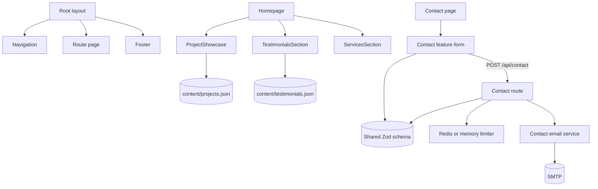
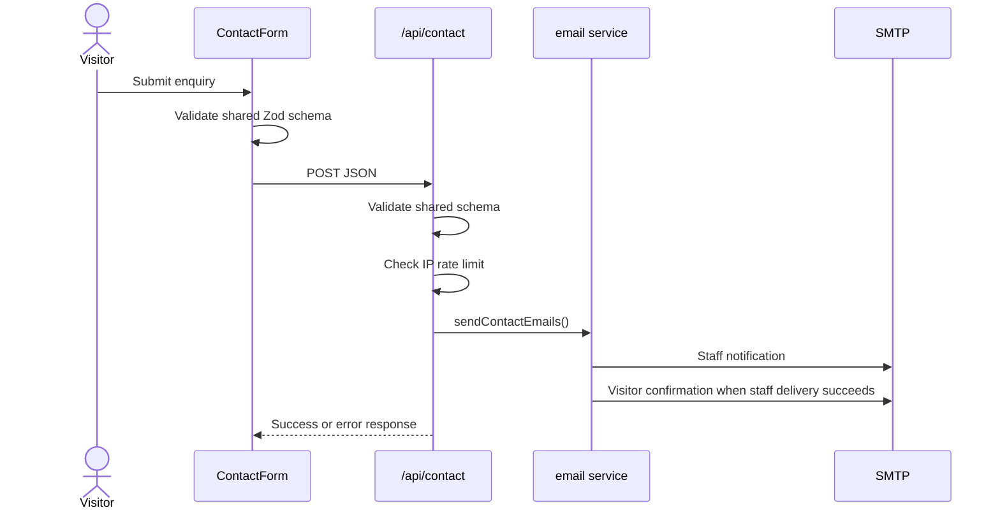

# Application architecture

## Purpose

This repository is the NLarge Global marketing website. Next.js App Router renders the public pages and delegates contact submissions to a server route that validates input and sends email through SMTP.

## Technology

| Concern | Implementation |
|---|---|
| Framework | Next.js 16 App Router |
| UI | React 19, TypeScript |
| Styling | Tailwind CSS 4 and `src/app/globals.css` |
| Fonts | Inter, Cormorant Garamond and Dancing Script through `next/font` |
| Forms | React Hook Form, resolver and shared Zod schema |
| Email | Nodemailer |
| Rate limiting | Optional Upstash Redis REST API with a process-memory fallback |
| Icons | React Icons |

## Folder structure

```text
src/
├── app/
│   ├── (marketing)/              # Marketing pages with transparent route-group URLs
│   │   ├── page.tsx              # /
│   │   ├── products/page.tsx     # /products
│   │   └── services/page.tsx     # /services
│   ├── api/contact/route.ts      # Contact HTTP boundary
│   ├── contact/page.tsx          # /contact
│   ├── privacy-policy/page.tsx
│   ├── terms-of-service/page.tsx
│   ├── layout.tsx                # Root layout and metadata
│   ├── robots.ts
│   └── sitemap.ts
├── components/
│   ├── layout/                   # Navigation and Footer
│   ├── sections/                 # Route-level presentation sections
│   ├── marketing/                # Reserved for reusable business presentation UI
│   └── ui/                       # Reserved for small reusable interface primitives
├── features/
│   ├── contact/
│   │   ├── api/rate-limit.ts
│   │   ├── components/ContactForm.tsx
│   │   ├── schemas/contact.ts
│   │   └── services/email.ts
│   └── showcase/
│       └── components/
│           ├── ProjectShowcase.tsx
│           └── TestimonialsSection.tsx
├── content/
│   ├── projects.json
│   └── testimonials.json
├── lib/
│   ├── env.ts
│   └── email/                    # Reserved for a generic email provider boundary
├── styles/
│   └── globals.css
└── utils/
```

## Ownership boundaries

- `app/` owns routing, metadata, layouts and API HTTP behavior.
- `components/layout/` owns elements shared across routes.
- `components/sections/` owns substantial presentation sections reused by page composition.
- `components/marketing/` and `components/ui/` are reserved for genuinely shared presentation primitives rather than route-specific duplication.
- `features/contact/` owns all implementation that is specific to contact enquiries: form UI, validation and SMTP delivery.
- `content/` owns structured local editorial content. It must not contain executable behavior.
- `lib/` owns small infrastructure services shared outside one feature.

## Route map

| Path | Source | Responsibility |
|---|---|---|
| `/` | `src/app/page.tsx` | Marketing proof, showcases, services and team |
| `/services` | `src/app/services/page.tsx` | Services presentation |
| `/products` | `src/app/products/page.tsx` | Product presentation |
| `/contact` | `src/app/contact/page.tsx` | Contact composition |
| `/privacy-policy` | `src/app/privacy-policy/page.tsx` | Privacy policy |
| `/terms-of-service` | `src/app/terms-of-service/page.tsx` | Terms of service |
| `/api/contact` | `src/app/api/contact/route.ts` | Contact submission endpoint |
| `/robots.txt` | `src/app/robots.ts` | Search crawler policy |
| `/sitemap.xml` | `src/app/sitemap.ts` | Public route index |

## Component graph



## Contact request flow



## Configuration

The application reads and validates environment variables through `src/lib/env.ts`.

| Variable | Required | Default | Purpose |
|---|---:|---|---|
| `NEXT_PUBLIC_SITE_URL` | No | `https://nlargecorp.com` | Canonical site URL |
| `SMTP_HOST` | No | `smtp.gmail.com` | SMTP host |
| `SMTP_PORT` | No | `587` | SMTP port |
| `SMTP_SECURE` | No | `false` | Use implicit TLS when `true` |
| `SMTP_USER` | Yes for delivery | — | SMTP account and sender |
| `SMTP_PASS` | Yes for delivery | — | SMTP account password or app password |
| `CONTACT_GENERAL_EMAIL` | No | `info@nlargecorp.com` | General/business/careers recipient |
| `CONTACT_SUPPORT_EMAIL` | No | `support@nlargecorp.com` | Support recipient |
| `UPSTASH_REDIS_REST_URL` | No | — | Distributed rate-limit store |
| `UPSTASH_REDIS_REST_TOKEN` | No | — | Distributed rate-limit token |
| `DEV_ALLOWED_ORIGINS` | No | — | Comma-separated Next.js development origins |

See `example.env` for the copyable template.

## Conventions

- Use kebab-case for directories and TypeScript modules where practical; React component names use PascalCase.
- Use the `@/*` alias for imports under `src/`.
- Client components declare `"use client"` first. Keep browser state below page composition where possible.
- Route files compose features and shared layout; feature-specific behavior stays under `features/<name>/`.
- Public metadata, canonical URLs, robots and sitemap must remain synchronized with public routes.
- Preserve the wine-red (`#602329`), warm-neutral, large-type visual system.
