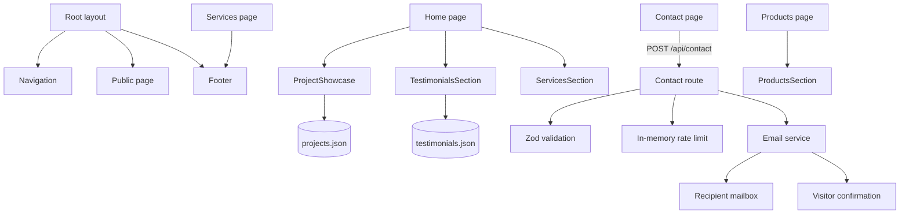
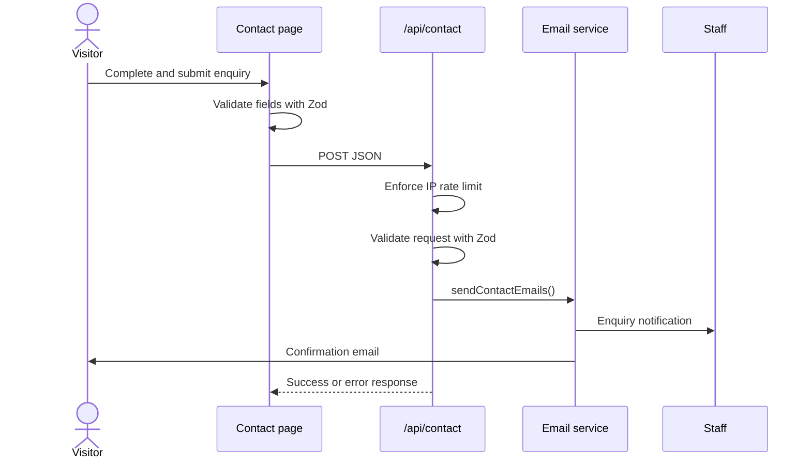

# Application architecture

## Purpose

NLarge Global is a server-rendered marketing website built with Next.js App Router. It presents company services, products, leadership, testimonials and contact options, then routes enquiries through a validated API to SMTP email delivery.

## Technology

| Concern | Implementation |
|---|---|
| Framework | Next.js 15.5 App Router |
| UI | React 19, TypeScript |
| Styling | Tailwind CSS 4, global custom CSS |
| Fonts | Inter, Cormorant Garamond and Dancing Script via `next/font` |
| Forms | React Hook Form and Zod |
| Email | Nodemailer |
| Animation | Motion, CSS transitions and keyframes |
| Icons | React Icons |

## Repository map

```text
.
├── public/                 # Images, logos, icons and web manifest assets
├── src/
│   ├── app/                # Routes, layouts, metadata, SEO and API handlers
│   │   ├── api/contact/    # Contact POST endpoint
│   │   ├── contact/        # Contact page and enquiry form
│   │   ├── privacy-policy/ # Privacy policy
│   │   ├── products/       # Product presentation
│   │   ├── services/       # Service capabilities
│   │   ├── terms-of-service/
│   │   ├── layout.tsx      # Root layout, global fonts and metadata
│   │   ├── page.tsx        # Homepage composition
│   │   ├── robots.ts       # Search crawler policy
│   │   └── sitemap.ts      # Public URL index
│   ├── components/         # Reusable site and page UI
│   ├── constants/*.json    # Showcase projects and testimonials
│   ├── lib/email.ts        # SMTP client and email templates
│   └── utils/smoothScroll.ts
├── AGENTS.md               # Concise agent operating guide
├── PRODUCT.md              # Product context and brand constraints
├── package.json
└── tsconfig.json           # Strict TypeScript and `@/*` alias
```

## Route map

| Path | Source | Purpose |
|---|---|---|
| `/` | `src/app/page.tsx` | Proof, services, testimonials, team and primary conversion CTA |
| `/services` | `src/app/services/page.tsx` | Development, AI, design, integration, launch and maintenance |
| `/products` | `src/app/products/page.tsx` | NLarge software products presentation |
| `/contact` | `src/app/contact/page.tsx` | Validated enquiry form |
| `/privacy-policy` | `src/app/privacy-policy/page.tsx` | Privacy policy |
| `/terms-of-service` | `src/app/terms-of-service/page.tsx` | Terms of service |
| `/api/contact` | `src/app/api/contact/route.ts` | Server-side enquiry submission |
| `/robots.txt` | `src/app/robots.ts` | Search crawler rules |
| `/sitemap.xml` | `src/app/sitemap.ts` | Public route sitemap |

## Component graph



## Rendering and composition

- `src/app/layout.tsx` owns global fonts, metadata and navigation progress. Pages render their own navigation and footer; there is no outer marketing shell route group.
- Homepage sections are composed directly in `src/app/page.tsx`.
- Interactive components use `"use client"` only where browser state, timers or DOM APIs are required.
- Project and testimonial content is local JSON, imported directly into its presentation component.
- Public routes share editorial spacing, near-black type, white/warm backgrounds and `#602329` wine red accents.

## Contact request flow



Email routing is based on query type: general, business and careers use `CONTACT_GENERAL_EMAIL` or `info@nlargecorp.com`; support uses `CONTACT_SUPPORT_EMAIL` or `support@nlargecorp.com`.

## Configuration

Required for successful contact delivery:

| Variable | Purpose |
|---|---|
| `SMTP_USER` | SMTP account and default sender |
| `SMTP_PASS` | SMTP account password or app password |

Optional:

| Variable | Default | Purpose |
|---|---|---|
| `SMTP_HOST` | `smtp.gmail.com` | SMTP server |
| `SMTP_PORT` | `587` | SMTP port |
| `SMTP_SECURE` | `false` | Use implicit TLS when `true` |
| `CONTACT_GENERAL_EMAIL` | `info@nlargecorp.com` | General inquiry recipient |
| `CONTACT_SUPPORT_EMAIL` | `support@nlargecorp.com` | Support recipient |

## Current operating constraints

- The API rate limiter is process-memory based and resets when a server instance restarts or when traffic moves across serverless instances. Use Redis or the site's database before relying on it as global protection.
- SMTP delivery and both route/service code are required for a successful response; a failed confirmation email currently prevents success completion even after the staff notification succeeds.
- The sitemap and robots policy use `https://nlargecorp.com`. Change both if the final production domain differs.
- Testimonials are stored locally and displayed in structured review data; avoid treating them as remotely submitted or verified without evidence.
- Legal content contains a fixed effective date and should be reviewed for jurisdiction-specific obligations before publication.
