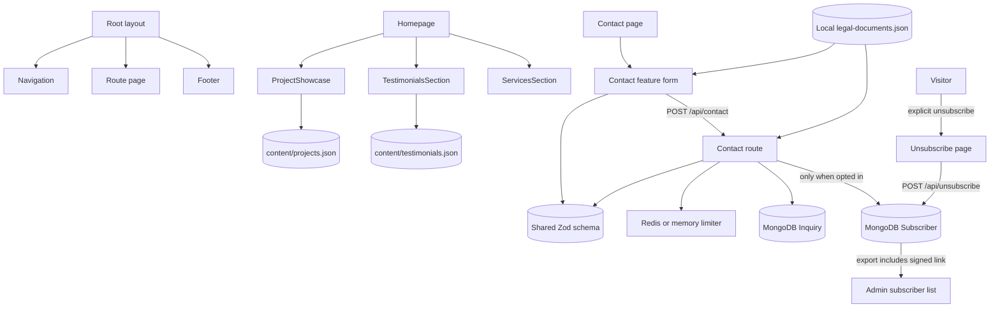
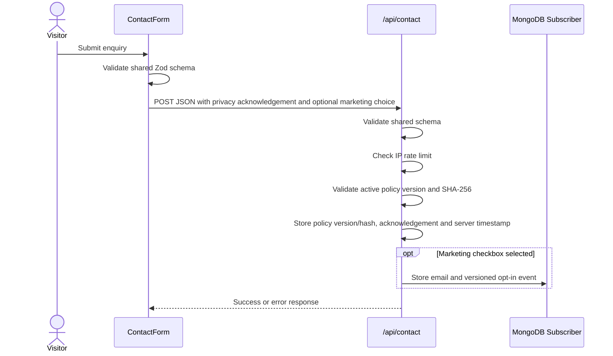

# Application architecture

## Purpose

This repository is the NLarge Global marketing website. Next.js App Router renders the public pages and delegates contact submissions to a server route that validates input and stores inquiries in MongoDB.

## Technology

| Concern | Implementation |
|---|---|
| Framework | Next.js 16 App Router |
| UI | React 19, TypeScript |
| Styling | Tailwind CSS 4 and `src/app/globals.css` |
| Fonts | Inter, Cormorant Garamond and Dancing Script through `next/font` |
| Forms | React Hook Form, resolver and shared Zod schema |
| Email | Nodemailer |
| Rate limiting | Optional Upstash Redis REST API with a process-memory fallback |
| Icons | React Icons |

## Folder structure

```text
src/
├── app/
│   ├── (marketing)/              # Marketing pages with transparent route-group URLs
│   │   ├── page.tsx              # /
│   │   ├── products/page.tsx     # /products
│   │   ├── services/page.tsx     # /services
│   │   └── guides/               # Practical editorial guides
│   │       ├── page.tsx          # /guides
│   │       └── [slug]/page.tsx   # Statically generated guide articles
│   ├── api/contact/route.ts      # Contact HTTP boundary
├── api/unsubscribe/route.ts  # Public unsubscribe action
├── unsubscribe/page.tsx      # Public email preferences page
│   ├── contact/page.tsx          # /contact
│   ├── support/page.tsx          # /support
│   ├── admin/                    # Private dashboard route surface
│   │   ├── layout.tsx            # Admin shell and admin-only metadata
│   │   ├── login/page.tsx        # Admin login
│   │   ├── prospects/            # Prospect list and detail pages
│   │   ├── page.tsx              # /admin overview placeholder
│   │   └── [section]/page.tsx    # Planned admin section placeholders
│   ├── api/admin/subscribers/   # Authenticated subscriber export and deletion
├── api/admin/auth/
│   │   ├── login/route.ts        # Login boundary
│   │   └── logout/route.ts       # CSRF-protected logout boundary
│   ├── privacy-policy/page.tsx
│   ├── terms-of-service/page.tsx
│   ├── layout.tsx                # Root layout and metadata
│   ├── robots.ts
│   └── sitemap.ts
├── components/
│   ├── layout/                   # Navigation and Footer
│   ├── sections/                 # Route-level presentation sections
│   ├── marketing/                # Reserved for reusable business presentation UI
│   └── ui/                       # Reserved for small reusable interface primitives
├── features/
│   ├── contact/
│   │   ├── api/rate-limit.ts
│   │   ├── components/ContactForm.tsx
│   │   ├── schemas/contact.ts
│   │   ├── models/subscriber.ts
│   │   ├── services/subscribers.ts
│   │   ├── services/unsubscribe-token.ts
│   │   ├── services/email.ts
│   │   └── consent.ts
│   └── showcase/
│       └── components/
│           ├── ProjectShowcase.tsx
│           └── TestimonialsSection.tsx
│   └── admin/
│       └── auth/
│           ├── rate-limit.ts
│           └── session.ts
│       ├── models/
│       │   ├── inquiry.ts
│       │   ├── conversation-entry.ts
│       │   └── email-record.ts
│       │   ├── prospect.ts
│       │   └── prospect-activity.ts
│       ├── services/
│       │   └── prospect-url.ts
│       ├── client.ts
│       ├── project.ts
│       ├── task.ts
│       ├── secret.ts
│       ├── document.ts
│       ├── payment.ts
│       ├── audit-event.ts
│       └── settings.ts
│       └── components/
│           ├── AdminShell.tsx
│           ├── AdminPlaceholderPage.tsx
│           ├── AdminTour.tsx
│           └── HelpTooltip.tsx
├── content/
│   ├── guides.ts
│   ├── projects.json
│   └── testimonials.json
├── lib/
│   ├── env.ts
│   ├── mongodb.ts                 # Cached Mongoose connection adapter
│   ├── mongoose-model.ts          # Development-safe model registration
│   └── email/                    # Reserved for a generic email provider boundary
├── styles/
│   └── globals.css
└── utils/
```

## Ownership boundaries

- `app/` owns routing, metadata, layouts and API HTTP behavior.
- `components/layout/` owns elements shared across routes.
- `components/sections/` owns substantial presentation sections reused by page composition.
- `components/marketing/` and `components/ui/` are reserved for genuinely shared presentation primitives rather than route-specific duplication.
- `features/contact/` owns all implementation that is specific to contact enquiries: form UI, validation and SMTP delivery.
- `content/` owns structured local editorial content. It must not contain executable behavior.
- `lib/` owns small infrastructure services shared outside one feature.

## Route map

| Path | Source | Responsibility |
|---|---|---|
| `/` | `src/app/(marketing)/page.tsx` | Marketing proof, showcases, services and team |
| `/services` | `src/app/(marketing)/services/page.tsx` | Services presentation |
| `/products` | `src/app/(marketing)/products/page.tsx` | Product presentation |
| `/guides` | `src/app/(marketing)/guides/page.tsx` | Guide index |
| `/guides/[slug]` | `src/app/(marketing)/guides/[slug]/page.tsx` | Static guide articles from `src/content/guides.ts` |
| `/contact` | `src/app/contact/page.tsx` | Contact composition |
| `/unsubscribe` | `src/app/unsubscribe/page.tsx` | Public, signed-token email unsubscribe |
| `/privacy-policy` | `src/app/privacy-policy/page.tsx` | Latest effective local Privacy Policy version |
| `/privacy-policy/[version]` | `src/app/privacy-policy/[version]/page.tsx` | Exact published Privacy Policy version |
| `/terms-of-service` | `src/app/terms-of-service/page.tsx` | Latest effective local Terms of Service version |
| `/terms-of-service/[version]` | `src/app/terms-of-service/[version]/page.tsx` | Exact published Terms of Service version |
| `/api/contact` | `src/app/api/contact/route.ts` | Contact submission endpoint |
| `/api/unsubscribe` | `src/app/api/unsubscribe/route.ts` | Records a subscriber opt-out |
| `/admin/subscribers` | `src/app/admin/subscribers/page.tsx` | Authenticated subscriber list, consent history, pagination and delete |
| `/api/admin/subscribers/export` | `src/app/api/admin/subscribers/export/route.ts` | Exports active subscribers and signed unsubscribe links |
| `/api/admin/subscribers/[id]` | `src/app/api/admin/subscribers/[id]/route.ts` | CSRF-protected subscriber deletion |
| `/admin` | `src/app/admin/page.tsx` | Admin overview shell placeholder |
| `/admin/[section]` | `src/app/admin/[section]/page.tsx` | Planned admin section shell placeholders |
| `/admin/prospects` | `src/app/admin/prospects/page.tsx` | Private prospect list, search and follow-up |
| `/admin/prospects/[id]` | `src/app/admin/prospects/[id]/page.tsx` | Prospect details and paginated activity |
| `/admin/login` | `src/app/admin/login/page.tsx` | Admin credential login |
| `/api/admin/auth/login` | `src/app/api/admin/auth/login/route.ts` | Admin login and session creation |
| `/api/admin/auth/logout` | `src/app/api/admin/auth/logout/route.ts` | Revocation with same-origin and CSRF checks |
| `/api/admin/prospects` | `src/app/api/admin/prospects/route.ts` | Authenticated prospect listing and manual creation |
| `/api/admin/prospects/[id]` | `src/app/api/admin/prospects/[id]/route.ts` | Authenticated prospect update and archive |
| `/api/admin/prospects/[id]/activities` | `src/app/api/admin/prospects/[id]/activities/route.ts` | Prospect activity timeline |
| `/api/admin/prospects/share` | `src/app/api/admin/prospects/share/route.ts` | Installed-PWA share target for links |
| `/robots.txt` | `src/app/robots.ts` | Search crawler policy |
| `/sitemap.xml` | `src/app/sitemap.ts` | Public route index |
| `/og-image.png` | `public/og-image.png` | Shared social preview image |

## Component graph



## Contact request flow



Admin subscriber exports contain only currently subscribed emails, the recorded marketing consent history, and a signed `/unsubscribe` URL. The unsubscribe page does not change subscription state on GET; an explicit POST records the withdrawal. Each subscription has a random address key, and links are signed with `UNSUBSCRIBE_TOKEN_SECRET`. A fresh opt-in rotates that address key, invalidating prior links. Changing `UNSUBSCRIBE_TOKEN_SECRET` invalidates previously issued links.

Legal content is authored append-only in `src/content/legal-documents.json` for the Privacy Policy, Terms of Service, and marketing-consent wording. This file is the only publishing source for policy body copy, effective dates, version summaries, SEO descriptions/keywords, and the contact acknowledgement and marketing opt-in wording. To publish an update, append a record only to the relevant array; do not edit or reorder published records. Give it a unique version and an ISO effective timestamp with an explicit timezone. Sections and acknowledgement use plain-text paragraphs or arrays of text/link segments, never HTML; `href` supports site-relative, HTTP(S), and `mailto:` links. Public pages select the version with the latest effective timestamp that is not in the future, so a future version can be appended and deployed in advance. Version-specific routes show effective historical text. SHA-256 fingerprints are calculated from canonical JSON with object keys sorted and array order preserved; the archived content is retained because a hash verifies a document but cannot recreate it. New contact acknowledgements store the active policy version and hash; stale policy submissions are rejected, and older acknowledgement records without hashes remain legacy records. The sitemap lists the stable legal routes without manually maintained policy dates. Admin/database publishing and notifications are deferred in `docs/FEATURES-LATER.md`.

## PWA prospect capture

The manifest launches the installed app on `/admin/prospects` and registers an Android share target. Deploy the site over HTTPS, install it from the browser’s app menu, and sign in before sharing a business link. The share target saves the link immediately as `To review`; if the admin session is missing, sign in and share again. Shared text is retained as notes, source is inferred only for recognized hosts, and no page content is scraped. The dashboard requires a network connection; it does not provide offline access. Archived prospects remain soft-deleted and can be found with the prospects list’s archived filter and restored.

On iPhone, install from Safari’s Share menu using **Add to Home Screen**. iOS does not provide the same installed-web-app share-target behavior, so copy the business link, open Prospects, and add it manually. Follow-up dates are in-dashboard only; there are no device push notifications.

## Configuration

The application reads and validates environment variables through `src/lib/env.ts`.

The admin Settings page can generate a bcrypt password hash and new 256-bit environment secrets; it displays them once and never updates environment configuration. Replacing `ADMIN_SESSION_SECRET` invalidates active admin sessions, and replacing `UNSUBSCRIBE_TOKEN_SECRET` invalidates previously issued unsubscribe links. Do not replace `MASTER_ENCRYPTION_KEY` directly: existing client data keys must first be re-wrapped under the new key. The planned migration is documented in `docs/FEATURES-LATER.md`.

| Variable | Required | Default | Purpose |
|---|---:|---|---|
| `NEXT_PUBLIC_SITE_URL` | No | `https://nlargecorp.com` | Canonical site URL |
| `MONGODB_URI` | Yes for persisted data | — | MongoDB connection for inquiry and subscriber records |
| `ADMIN_SESSION_SECRET` | Yes for admin | — | HMAC key for admin session tokens |
| `UNSUBSCRIBE_TOKEN_SECRET` | Yes for subscriber export and unsubscribe | — | HMAC key for unsubscribe links; generate an independent secret with `node -e "console.log(require('node:crypto').randomBytes(32).toString('base64'))"` |
| `ADMIN_PASSWORD_HASH` | Yes for admin | — | bcrypt hash of the admin password; generated with bcrypt cost 12 |
| `MASTER_ENCRYPTION_KEY` | Yes for encrypted client secrets | — | Key-encryption key for wrapping client-specific encryption keys |
| `SMTP_HOST` | No | `smtp.gmail.com` | SMTP host |
| `SMTP_PORT` | No | `587` | SMTP port |
| `SMTP_SECURE` | No | `false` | Use implicit TLS when `true` |
| `SMTP_USER` | Yes for delivery | — | SMTP account and sender |
| `SMTP_PASS` | Yes for delivery | — | SMTP account password or app password |
| `CONTACT_GENERAL_EMAIL` | No | `info@nlargecorp.com` | General/business/careers recipient |
| `CONTACT_SUPPORT_EMAIL` | No | `support@nlargecorp.com` | Support recipient |
| `UPSTASH_REDIS_REST_URL` | No | — | Distributed rate-limit store |
| `UPSTASH_REDIS_REST_TOKEN` | No | — | Distributed rate-limit token |
| `DEV_ALLOWED_ORIGINS` | No | — | Comma-separated Next.js development origins |

See `example.env` for the copyable template.

## Development admin data

After creating a fresh MongoDB database, run `npm run seed:admin` to insert linked demo clients, projects, tasks, inquiries, secrets, documents, and payments. The command creates the two base records plus 30 varied fixture clients, 60 projects, 180 tasks, 90 secrets, 60 documents, 60 payments, and 30 inquiries. Fixtures include boundary dates, long text, unusual Unicode and punctuation, small amounts, mixed statuses, and unassigned inquiries for pagination and UI edge-case testing. The command is explicit and never runs during application startup; it replaces only records with the seed IDs, so it can be run again safely.

## Conventions

- Use kebab-case for directories and TypeScript modules where practical; React component names use PascalCase.
- Use the `@/*` alias for imports under `src/`.
- Client components declare `"use client"` first. Keep browser state below page composition where possible.
- Route files compose features and shared layout; feature-specific behavior stays under `features/<name>/`.
- Public metadata, canonical URLs, robots and sitemap must remain synchronized with public routes.
- Preserve the wine-red (`#602329`), warm-neutral, large-type visual system.
- The admin surface uses the same brand accents with a separate warm-neutral workspace layout. Step 1 contains visual placeholders only; authentication, persistence, and protected operations are added in later features.
- The admin walkthrough and contextual help are client-side UI preferences only during the foundation phase. Tour completion is stored in browser storage until authenticated admin preferences are implemented.
- MongoDB access is server-only through `src/lib/mongodb.ts`; it fails explicitly when `MONGODB_URI` is missing or the connection cannot be established. Models must use `getOrCreateModel()` to avoid development recompilation errors.
- Admin sessions are opaque random cookies whose HMAC is stored in the `AdminSession` collection. Protected pages query the server-backed session, enforce expiry/revocation, and redirect unauthenticated users to `/admin/login`; logout requires a matching same-origin request and constant-time CSRF token comparison.
- Public contact submissions validate with the shared schema, apply rate limiting, and persist to `Inquiry` with `source: website`, public origin, an acknowledgement linked to the active local Privacy Policy version and SHA-256 fingerprint, and an idempotency key. Marketing consent is optional; only an affirmative choice creates or updates a separate `Subscriber` record with the exact wording, version, timestamp, and source. These routes do not send marketing email. Manually entered inquiries have no public acknowledgement. Both inquiry status and priority are explicitly managed by admins, with new records defaulting to `new` and `normal`. `converted` is a manual status and is never inferred from linking a client.
- Subscriber administration is authenticated and paginated. CSV export includes only subscribed addresses plus their consent evidence and signed unsubscribe URL. Deletion permanently removes the subscriber-list record and its consent history, with CSRF and explicit confirmation; any separate inquiry and its consent evidence remain. Public unsubscribe requires a valid signed token and explicit POST; the email and consent history remain in the suppression record.
- Inquiry conversation entries are stored separately from the inquiry, scoped by `inquiryId`, and sorted newest-first by editable `occurredAt` timestamps with cursor pagination. Channel, direction, and text filters are applied by the authenticated API; creation requires CSRF validation. Email reply defaults are loaded from dashboard settings only when the reply dialog opens.
- Dashboard replies are the only current path that uses SMTP. Reply text is escaped before HTML generation, includes a plain-text fallback, stores delivery metadata in `EmailRecord`, and creates an outbound `ConversationEntry`.
- Client records stay small and inquiries reference an optional `clientId`. Linking, unlinking, and relinking are authenticated server operations; client detail pages query only their linked inquiries.
- Prospects are separate from inbound inquiries. They support URL-only capture, explicit status, source, notes and in-dashboard follow-up dates; activity is stored separately and cursor-paginated. The installed PWA manifest receives Android share actions at `/api/admin/prospects/share`; capture requires an active admin session and accepts only HTTP(S) URLs. No scraping or device push notifications are used.
- Projects belong to exactly one client and contain technical/delivery details. Tasks are separate records linked to projects (and inherit the client), with indexed status and due-date fields for later overview and follow-up views.
- Client secrets use a unique client data key wrapped by `MASTER_ENCRYPTION_KEY`; secret values store only ciphertext, IV, authentication tag, and key version. Lists exclude encrypted fields, and reveal requires admin re-authentication.
- Client documents use private R2 object keys under `clients/{clientId}/documents/...`; uploads validate size, declared type, and file signature, while access uses five-minute signed URLs. Metadata and object deletion are coordinated with orphan cleanup on metadata failure.
- Payments are client-scoped records with bounded amount/currency/method/status fields and optional references to private proof documents. Payment credentials are not accepted by the schema.
- Audit events are append-only, indexed by time and resource, and carry a bounded request ID, a sanitized resource-label snapshot, and metadata filtered through an explicit safe-key allowlist. Stable resource IDs remain available for exact tracing; new writes exclude credentials, hashes, contact details, message bodies, and request payloads, and audit readers filter legacy metadata through the same allowlist.
- Health checks are private and return only configured/ok/error summaries for environment, MongoDB, SMTP, and R2. Public contact submission does not call Health.
- Settings are a single dashboard preference record. Password hash generation returns a bcrypt hash once and never persists the plaintext or hash. Password generation, login, and re-auth reject passwords longer than bcrypt's 72-byte input limit.
- Overview metrics are derived from current collections and do not have a separate collection. New inquiries use `status: new`, while recent inquiries use creation order across statuses; task/payment/secret signals use indexed collection queries.
- Client exports are created through authenticated `POST /api/admin/exports`, exclude secret values, and optionally include private R2 document contents. ZIPs use random private object keys and short-lived `ExportJob` download tokens; creation is audited, while expired-object cleanup is deferred in `docs/FEATURES-LATER.md`.
